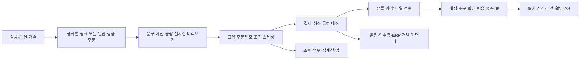

# 쇼핑몰 + ERP 자동커스텀 플랫폼 이관서 · 벨라비타 레퍼런스

2026-11-15 한국 시간 기준. 목적은 지금까지 만든 벨라비타 쇼핑몰·주문 운영 기능을 새 플랫폼의 첫 샘플로 옮기는 것이다. **검증된 공통 업무 모듈, 벨라비타 설정·자산, 외부 연동 어댑터를 분리해 재사용한다.** 이 문서는 이관 자료이며 운영 병합·배포 지시가 아니다.

## 1. 기준 코드와 배포 상태

| 구분 | 확인한 기준 | 의미 |
|---|---|---|
| 저장소 / PR | `kshyuk96-cell/bellavita-taesan`, PR #20 | 기존 초안 PR, 열림·미병합 상태 확인 |
| 개발 브랜치 | `codex/shop-backend` | 쇼핑몰·주문 운영과 추가 개선 소스 |
| 최종 실행 코드 | `4df6bc54a8a1d1f71fec152447ff9e444097f9d4` | 4차까지 추가 개발 완료. 전체 회귀 189개 기준 |
| 이 브랜치와 main의 공통 기준 | `9474f6d1d5cd0589ae09c360d90745cbe224d41a` | 이후 main의 별도 변경 5개는 아직 미통합 |
| 조회한 최신 main | `db742efa7ec7291293659e02dd1e50aa26a1465c` | 기존 Render main 서비스에서 Live 확인 |
| 독립 모의 서버 | `d423e89f14603001b506b708734beda8b55a16d2` | 상품 4개와 모의 주문 검증. 뒤의 추가 개선 40개는 미배포 |

고객 샘플: https://bellavita-shop-verification-v3b4.onrender.com/shop . 이 URL은 위 모의 배포 기준이며 최신 추가 개발 화면이라고 안내하지 않는다.

직접 운영 배포·실가맹점 결제·실발송·실영수증·실제 인쇄·운영 원장 쓰기는 이번 추가 개발에서 하지 않았다. 기존 서비스가 운영하는 다른 업무의 성공·실패를 이 사실로 추정하지 않는다.

### 최신 main에서 보존할 별도 작업

main에는 배송/재고 조회 보완과 ERP 초대장·AI 게이트웨이가 추가됐다. 이번 PR 소스에 포함된 것으로 착각하지 않는다.

- `erp_invitations.py`, `erp_invitation_render.py`: ERP 전용 비동기 초대장, 업로드·미리보기·게시, 기존 확인된 상품 연결.
- `erp_ai.py`: 기존 서버 키를 사용하는 제한된 AI 게이트웨이.
- `/erp/invitations/capabilities`, `/erp/invitations/template-check`, `/erp/invitations/jobs`, `/erp/invitations/uploads`, `/erp/invitations/jobs/{id}` 관련 경로.
- `/erp/ai/responses`, `/erp/ai/audio/transcriptions` 관련 경로. 현재 main의 디스패처 인증 안에서 사용한다. 이번 작업에서 실제 호출하거나 키를 검증하지 않았다.
- `ERP_INVITATION_TOKEN`, `ERP_INVITATION_DATA` 등 설정은 비공개 환경 설정이다. 이관 자료에 값은 없다.

`git merge-tree --write-tree`로 작업 트리를 건드리지 않고 확인한 결과 **agent.py에 병합 충돌**이 있다. 자동 해결하거나 실제 병합하지 않았다. 기존 저장소에서 통합한다면 최신 main의 ERP 디스패치·배송/재고 경로와 PR의 쇼핑몰·내보내기 경로를 함께 보존한 뒤 새 main 테스트까지 다시 실행해야 한다. **189개 통과는 PR 코드 기준이며 최신 main 5개 변경의 통합 성공 근거가 아니다.**

## 2. 전체 기능 흐름



현재 제가 개발한 부분은 **벨라비타 단일 매장의 쇼핑몰·주문 운영 레퍼런스**다. 여러 입점사를 위한 테넌트 격리, 범용 폼/워크플로 생성 엔진, 통합 회원·장바구니, 독립적인 재고·구매·회계 ERP 전체를 구현한 것으로 보고하지 않는다. 별도로 개발 중인 새 플랫폼의 구현 현황과도 구분한다.

## 3. 구현 자산과 검증 범위

| 영역 | 구현·재사용할 내용 | 상태·한계 |
|---|---|---|
| 상품·옵션 | 상품 등록/수정, 옵션 묶음·추가금·직접 입력, 전시/판매 중지, revision 충돌 검사 | 네 상품과 다양한 선택지 모의 검증 |
| 행사별 링크 | 93,500/99,000원 링크 발급, 행사 정보·가격·옵션 스냅샷, 반복 발급·판매 중지/재개 | 기존 링크 조건 보존 검증 |
| 고객 주문 | 네 상품 전시, 고객 설치 정보, 문구·보내는 분·중량 표시, 주문자 복사 | 모바일·PC 검증. 회원·장바구니 없음 |
| 자동 초대장 | 기존 행사 초대장과 자체 주문서 연결, 사진/행사 조건 저장 | 두 가격 경로. 상품 복사와 기존 상품 조회 모드는 구분 |
| 족자 미리보기 | HTML/CSS 레이어·캔버스, 사진/중량/문구/보내는 분 실시간 반영, 긴 글자 배치 | 입력마다 AI 이미지를 생성하는 방식 아님 |
| 결제 | 서버 금액 계산, 주문·결제번호 대조, 중복·역순·부분취소·전체취소, 타임아웃 대조 | 페이앱 어댑터·모의 검증. 실제 가맹점 성공은 미확인 |
| 메시지 | 영속 대기열, 중복/결과 불명 보호, 직원·고객 링크 분리, 접수/수신 구분 | 알림톡 어댑터 있음. 실제 수신 미검증 |
| 현금영수증 | 발급/취소·부분취소 정정, 과세 구분/발급 주체 제어, 기발급 20021 대조 | 합성 자료 모의 검증. 실제 발급 주체·세구분 미확정 |
| 제작 | 입력 샘플 이미지, 버전·해시가 있는 PNG/PDF, 검수·정정 후 재검수 | 실제 장비 실행 미실시. 실물 족자 규격 미확정 |
| 배송 | 담당자 배정·인수, 3단계 상태, 설치 사진·공개·고객 확인 | 합성 업무 리허설 통과 |
| 정정·AS | 원접수 보존, 정정 승인과 유효 정보 분리, AS/재배송 사건·사진·이력 | 금융 상태를 임의 덮어쓰지 않음 |
| ERP 전달 | 이벤트 claim/lease/ack, 수신 중복 제거, 별도 원장·제작 대기열 | 실제 외부 ERP·인쇄·운영 시트 쓰기 미실시 |
| 관리자 | 전체 검색·필터·정렬·CSV, 업무·인계·즐겨찾기·교육·도움말·상태 표시 | 현재 PR에 다수 기능 구현, 신규 추가분 미배포 |
| 정산·보존 | XLSX/CSV, 부분취소 대조, SQLite 백업·암호화·복구·체크섬 | 모의/독립 복구 성공. 무인 외부 인증과 운영 원본 검사 별도 |

## 4. 최근 추가한 40개와 커밋

| 묶음 | 커밋 | 10개 기능 | 문서 |
|---|---|---|---|
| 1차 고객 결제 전 | `ccfb4bb` | 실시간 요약, 항목 수정, 글자 수, 휴대폰 검사, 영수증 번호 검사, 오류 모음, 입력 진행, 이탈 알림, 모바일 금액/확인, 확인 후 초기화 | [1차](prepayment-improvements-batch-01.md) |
| 2차 관리자 검색 | `cf96d6f` | 조건 해제, 검색 강조, 정렬, 연락처 가림, 검색 CSV, 빈 결과 안내, 상세 복귀, 설치 정보 복사, 취소/보류 표시, 검색 안내 | [2차](admin-improvements-batch-02.md) |
| 3차 관리자 보호 | `9efa828` | 미저장 경고, 중복 저장 차단, 만료 시간, 검색 미적용, CSV 확인, 열 선택, 자동 재가림, 단축키, 업무 도움말, 상세 내부 이동 | [3차](admin-improvements-batch-03.md) |
| 4차 고객 안내 | `4df6bc5` | 추가금 내역, 금액 차이, 주소 길이, 과거 행사 검사, 한국 날짜 안내, 중량/호수 설명, 필수/선택, 개별 오류, 공백 정리, 다음 입력 이동 | [4차](checkout-improvements-batch-04.md) |

위 커밋은 증분이다. 이전 PR 기능 없이 마지막 커밋 하나만 붙이면 전체 쇼핑몰이 생기는 것이 아니다. 파일별 의존성·공용 DOM·리셋 이벤트를 각 문서에서 함께 확인한다.

## 5. 플랫폼 공통 기능 / 벨라비타 설정 / 어댑터로 나눌 것

### 공통 업무 모듈

상품·옵션·판매 제안, 가격 스냅샷, 주문, 결제 이벤트, 알림 대기열, 영수증, 제작 산출물·검수, 배송·배정·사진, 정정·AS, 관리자 업무, 집계·백업을 모듈로 재사용한다. 코드의 화면 이름을 바꾸는 것만으로 테넌트 지원이 완성되는 것은 아니다.

### 벨라비타 샘플 설정

[샘플 설정 JSON](../handoff/bellavita.sample.json)은 **참고용이며 대상 플랫폼이 정한 공식 import 스키마가 아니다.** 상품/옵션 원본은 `assets/shop/catalog.json`과 `shop_catalog.py`의 변환을 기준으로 한다.

- KRW 정수 금액, Asia/Seoul.
- 공개 샘플 4개: 웨딩 사진·결혼 축하·행사 축하·근조 액자화환. 원본 ID 1454214, 1440817, 1452802, 1969605.
- 기본가 110,000원, 선택 예시 +55,000원 = 165,000원. 행사별 93,500/99,000원과 다른 가격 정책이다.
- 축하 문구·보내는 분, 쌀 중량/액자 호수, 청첩장 주소, 행사장/설치 주소/일시 등은 이 업종의 주문 필드다. 모든 쇼핑몰의 필수 항목으로 고정하지 않는다.
- 디자인·로고·색상·문구·사진·상품 상세·권장 글꼴과 직함 분리 규칙을 테넌트 설정/템플릿으로 분리한다.
- 액자 공개 옵션 600×400mm, 700×467mm와 화면 비율은 구분한다. 족자 실측 mm는 미확정이다. 렌더러 기본 출력값을 공식 제작 규격으로 취급하지 않는다.
- catalog의 inventory는 과거 수집 시점 값이다. 새 ERP의 실제 재고 초기값이나 재고 동기화 완료 근거로 사용하지 않는다.
- 상품 과세/면세·영수증 발급 주체·실제 메시징 업체는 null 상태로 인계한다. 모의 TG02를 운영 상품에 복사하지 않는다.

현재 코드 일부는 ‘상품 선택’, ‘축하 문구’ 같은 표시 이름과 10/20/30kg·호수 문자열을 인식한다. **자동커스텀 플랫폼에서는 표시 이름 대신 의미 키와 typed field/widget 규격으로 바꿔야 한다.** 레이블만 자유롭게 바꾸면 미리보기 연결이 끊길 수 있다.

### 외부 어댑터

페이앱, 알림톡, 블로그페이, 기존 카카오 업무 채널, 시트/ERP, 제작 수신기, 백업 저장소를 어댑터로 분리한다. 공급사별 번호·상태·인증·결과 불명 정책을 공통 주문 도메인에 직접 하드코딩하지 않는다. 실제 인증값은 이관 파일에 없다.

## 6. 모듈 지도

| 파일군 | 주요 역할 |
|---|---|
| `shop.py`, `shop_catalog.py`, `seed_shop_catalog.py` | 상품·옵션·발급 링크·카탈로그 |
| `invitation.py`, `blogpay.py` | 기존 초대장·블로그페이 상품 연결 |
| `checkout.py`, `checkout.html` | 공용 주문 검증·금액·결제·고객 HTML |
| `checkout_preflight.js`, `checkout_guidance.js` | 고객 입력·확인·안내 20개 |
| `scroll_sender.py`, `order_sample.py` | 보내는 분 규칙과 주문 샘플 렌더 |
| `production_files.py`, `order_amendments.py`, `partial_reviews.py` | 버전 파일·검수·정정·부분취소 재개 판단 |
| `order_ops.py`, `order_messages.py`, `alimtalk.py`, `cash_receipts.py` | 배송 상태·메시지 대기열·알림톡·영수증 |
| `shop_dispatch.py`, `assignment_batches.py`, `delivery_photos.py`, `shop_service.py` | 배정·CSV 검토·설치 사진·AS |
| `order_handoff.py`, `shop_receiver.py` | ERP/제작 연계 이벤트와 독립 수신기 |
| `shop_admin_queries.py`, `shop_admin_review.py/.js`, `shop_admin_guard.js` | 검색·내보내기·저장/만료 보호 |
| `shop_admin_layout.py`, `shop_admin_team.py`, `shop_admin_daily.py`, `shop_admin_workflow.py`, `shop_admin_shortcuts.py`, `shop_admin_launch.py` | 화면 배치·업무·인계·매뉴얼·운영 점검 |
| `shop_sales.py`, `shop_settlement.py`, `shop_diagnostics.py`, `shop_readiness.py` | 집계·대조·진단·연결 준비 |
| `manage_data.py`, `scheduled_backups.py`, `external_backups.py` | 백업·주기 실행·암호화·외부 복구 검증 |
| `agent.py` | 기존 카카오/직원/시트와 위 HTTP 경로를 묶는 진입점. 새 플랫폼에는 그대로 덮어쓰지 말고 경로 어댑터로 분해 |
| `shop_verification.py` | 모의 전용 실행기. 운영 결제 환경으로 전환하는 파일이 아님 |

main 전용 ERP 게이트웨이 파일은 별도 main 참조 소스에서 가져온다. 기존 배송/재고/직원 기능은 그쪽 최신 변경을 우선 보존한다.

## 7. 데이터 모델과 이관 시 지킬 규칙

[참고 SQL](../handoff/reference-schema.sql)과 [테이블 목록](../handoff/reference-tables.json)은 **빈 임시 DB에서 생성한 69개 테이블의 구조**다. 운영 DB 덤프나 실제 고객 데이터가 아니다. 기존 DB에 바로 실행할 마이그레이션 파일도 아니다.

| 논리 모델 | 현재 테이블/자료 | 이관 규칙 |
|---|---|---|
| 상품·판매 제안 | `shop_products`, `shop_offers` | revision, 이벤트·가격·옵션 스냅샷 보존 |
| 주문·결제 | `invitation_orders`, `payment_events`, `payment_checks` | 고유 주문번호·원금액·원결제번호·개별 취소 이벤트 보존 |
| 메시지·영수증 | `shop_messages`, `shop_message_checks`, `shop_cash_receipts`, `shop_receipt_*` | 접수와 실제 성공 구분, uncertain/held를 임의 성공 처리하지 않음 |
| 제작·정정 | `shop_artifacts`, `shop_artifact_reviews`, `shop_amendments`, `shop_amendment_events`, `shop_partial_reviews` | 원접수와 유효 승인본 분리, 해시·버전·검수 보존 |
| 배송·고객 확인 | `shop_fulfillment`, `shop_stage_history`, `shop_assignments`, `shop_delivery_*`, `shop_service_*` | 결제 상태와 배송 상태를 별도 축으로 유지 |
| 업무·이력 | `shop_operator_*`, `shop_saved_searches`, `shop_shift_snapshots`, `shop_product_changes` 등 | 내부 메모와 고객 전달 내용을 분리 |
| 연계 이벤트 | `shop_handoff` | 이벤트 ID·digest·lease·ack·보류 조건 보존 |
| 백업 | `shop_backup_runs`, `shop_external_backups` | 로컬 성공·외부 저장·실제 복구 검증을 구분 |

금융 상태 예: requesting / waiting / failed / paid / partial_cancel / cancelled. 배송은 confirmed / shipping / delivered. 제작 검수·정정·AS를 이 두 축에 억지로 합치지 않는다.

수신기는 별도 `receiver.sqlite3`의 received_events / order_ledger / production_queue를 사용한다. [수신기 참고 SQL](../handoff/receiver-reference-schema.sql)을 함께 본다. 송신 서버와 같은 데이터 디렉터리를 사용하지 않는다. 최신 main의 ERP 초대장도 별도 `erp-invitations/journal.sqlite`를 사용하므로 jobs 테이블을 이름만 보고 기존 jobs와 합치지 않는다.

### 불변 조건

1. 금액은 서버의 상품/제안 스냅샷으로 다시 계산한다.
2. 기존 주문·발급 링크를 원본 상품 수정으로 바꾸지 않는다.
3. 같은 주문 시도의 재제출과 같은 취소 통보를 중복 실행하지 않는다.
4. 타임아웃/응답 불명은 대조 상태로 남기며 새 외부 요청을 자동 재시도하지 않는다.
5. 부분취소 원결제금액·취소 누계·잔액과 개별 취소번호를 분리한다.
6. 결제 확인·유효한 제작 파일 검수 전에 실제 제작을 접수하지 않는다.
7. 고객 샘플/주문 링크에 관리자·직원 작업 권한을 섞지 않는다.
8. ERP/제작 수신 중복 제거와 실제 인쇄 장비의 동작을 같은 ‘정확히 한 번’ 보장으로 보고하지 않는다.

## 8. 멀티테넌트·자동커스텀으로 전환할 부분

현재 JSON/DB·전역 환경변수·데이터 디렉터리는 한 업체 기준이다. 새 플랫폼의 TenantContext에 따라 상품·주문·파일·직원 권한·조회·내보내기·이벤트·백업을 분리해야 한다. 기존 ID 앞에 이름만 붙이는 것으로 격리가 완성되지 않는다.

공통 API/서비스 경계는 TenantContext + 사용자 권한 + 표준 입력/스냅샷을 받도록 만든다. 결제번호·상품 ID·이벤트 중복 키의 유일 범위도 tenant/provider/merchant를 포함하는지 검토한다. 현재 상품 ID는 벨라비타 원본 ID 기반 결정값이므로 다른 업체에 그대로 복제하지 않는다.

단일 인스턴스 SQLite는 현재 레퍼런스 구조다. 새 플랫폼의 동시 사용자·여러 서버 요구에 맞는 DB와 파일 저장소를 선택하되 트랜잭션·유일 제약·버전 검사·파일 해시를 유지한다. 시간은 timezone 정보를 보존하고 표시에는 테넌트 시간대를 사용한다. 현재 거래 로직은 KRW/한국 시간 검증이며 다른 통화 지원이 완료된 것은 아니다.

기존 관리자 권한은 카카오 직원 확인과 시간 제한 서명 링크를 사용한다. 플랫폼 계정·테넌트별 역할·작업자 감사 이력과 연결할 별도 계층이 필요하다. 고객 회원 기능이 없는 현 링크 방식도 대상 플랫폼의 고객 권한 정책에 맞게 검토한다.

자동커스텀 엔진은 업종별 필드·옵션·렌더러·상태 전이·메뉴·권한·어댑터 설정을 구성해 UI/워크플로를 만들도록 새로 연결한다. 지금 코드의 설정 가능 부분을 그 엔진의 초기 모듈로 삼되, 범용 엔진 자체가 이미 구현됐다고 설명하지 않는다.

## 9. 미연결·실검증 대기

- 페이앱 사업자 가입은 운영자 확인. 실제 연동 키·허용 시험 수단·실제 승인/취소 대조는 미검증.
- 알림은 **카톡만, 샘플은 이미지 확인 링크**. 문자/MMS 대체 발송은 끈다. 기존 MMS 코드는 보존돼 있지만 첫 운영 채널이 아니다.
- SOLAPI 어댑터는 구현돼 있으나 사용자는 SOLAPI 계정이 없다. 페이앱이 일반 주문·배송 알림 API를 제공하는지 사용자가 확인 중이다. 결제요청 카톡 지원만으로 일반 메시징 지원을 확정하지 않는다.
- 현금영수증의 실제 상품 세구분·단일 발급 주체·발급/취소 실적 대조가 남았다. 블로그페이 자동발급 설정이 새 쇼핑몰에 상속된다는 근거는 미확인.
- Render 운영 설정 `TAESAN_DATA=/var/data`는 사용자 확인, 마운트와 일치. 실제 운영 DB/초대장 파일의 무결성·백업/복구를 이번에 검사하지 않았다.
- 암호화 외부 백업 수동 저장·재다운로드·복구 근거는 있으나 서버의 무인 자동 업로드 인증은 별도다.
- 실제 출력 규격, 인쇄 장비·운영 ERP·운영 시트 쓰기와 직원 실사용 리허설은 별도다.

## 10. 검증 재현과 실행 환경

Python 3.12, requirements.txt의 Python 의존성, 로컬 HTTP를 열 수 있는 환경이 필요하다. 브라우저 테스트에는 Playwright와 `/usr/bin/chromium`이 필요하다. 현 검증 환경의 Playwright는 1.62.0이다. Playwright는 현재 런타임 requirements.txt에 없으므로 새 개발 환경에 별도로 준비한다. OS의 Chromium 경로가 다르면 테스트 실행기의 경로를 맞춘다.

운영 경로·인증값을 상속하지 않는 임시 TAESAN_DATA와 모든 외부 쓰기 비활성 설정에서 실행한다. 비밀값을 테스트 문서/명령 인수/공유 로그에 기록하지 않는다.

```sh
.venv/bin/python -m unittest discover -s tests
PYTHONPATH=tests .venv/bin/python tests/browser_checkout_preflight.py
PYTHONPATH=tests .venv/bin/python tests/browser_checkout_guidance_batch04.py
PYTHONPATH=tests .venv/bin/python tests/browser_shop_catalog.py
PYTHONPATH=tests .venv/bin/python tests/browser_admin_review_batch02.py
PYTHONPATH=tests .venv/bin/python tests/browser_admin_guard_batch03.py
.venv/bin/python tests/rehearse_catalog.py --output /새/독립/검증/경로
.venv/bin/python tests/rehearse_shop.py --output /다른/새/독립/검증/경로
```

최종 PR 실행 코드 전체 회귀 189개(89.151초). 4차 고객 안내는 미국/일본 기기 시간대에서 한국 자정·행사 경과를 가상 시간으로 확인했고 모바일 390/PC 1280px에서 통과했다. 이전 상품·주문·관리자 검증은 각 validation JSON의 수행 시점과 커밋을 따른다. 과거 성공을 이번 모든 공급사/운영 검증으로 확대하지 않는다.

## 11. 인수 에이전트에게 전달할 작업 지시

> 이 문서와 handoff 자료를 기준으로 벨라비타를 새 쇼핑몰+ERP 자동커스텀 플랫폼의 첫 샘플 테넌트로 이관한다. 기존 기능을 공통 모듈/벨라비타 설정/어댑터로 분리하고 대상 플랫폼의 기존 기능과 매핑한다. 최신 main의 ERP 초대장·AI 게이트웨이와 배송/재고 변경을 보존하며 agent.py 충돌을 무시하거나 이전 파일로 덮어쓰지 않는다. 먼저 모의 결제와 합성 데이터로 상품→주문→결제 통보→제작 검수→배송→취소/복구를 재현한다. 고유 주문번호·스냅샷·멱등성·권한·보류 상태를 유지한다. 실제 고객 DB·API 키·개인 테스트 번호를 샘플에 복사하지 않는다. 자동 쓰기·실결제·실발송·인쇄는 끈다. 대상 플랫폼 모델/경로와 189개 PR 검증을 매핑하고 통합 후 최신 main 시험을 추가한다. 기능 미연결과 모의 성공을 구분해 보고한다. 운영 배포는 별도 요청에 따라 진행한다.

## 12. 다음 이관 개발 제안 10개

대상 플랫폼에 이미 구현된 기능은 새로 만들지 않고 연결·매핑만 한다.

1. 플랫폼의 tenant/user/role 모델과 벨라비타 데이터·권한 매핑.
2. 상품·옵션·커스텀 입력의 의미 키/표준 스키마 정의.
3. 벨라비타 샘플 테넌트와 4개 상품의 합성 데이터 시드.
4. 브랜드·사진·글꼴·치수·미리보기 템플릿 설정 분리.
5. 결제/제작/배송/AS의 분리된 상태 머신 연결.
6. PayApp/알림톡/영수증 공급사 어댑터 인터페이스 정리.
7. 테넌트별 이벤트·멱등 키와 ERP 수신 계약 정리.
8. 파일 저장·버전·해시·백업과 대상 플랫폼 저장소 매핑.
9. 고객/직원/관리자 경로와 역할별 접근 검증 연결.
10. 벨라비타 전체 리허설을 플랫폼 통합 테스트로 재현.

참고: [관리 매뉴얼](shop-admin-manual.md), [자동 초대장·족자 지시서](automatic-invitation-scroll-development-brief.md), [기존 출시 현황](shop-first-release.md), [실제 연동 검증 절차](shop-live-verification-runbook.md).
