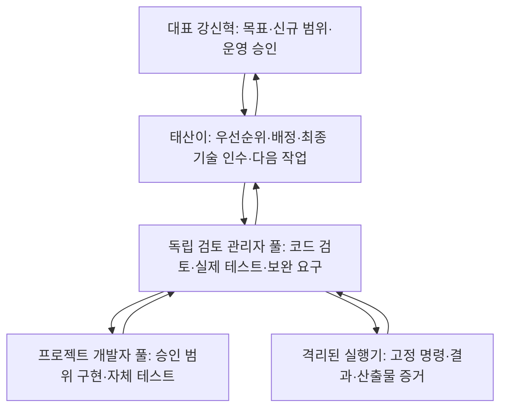

# 태산이 3단계 개발 조직 검토 보고서

수신: 강신혁 대표. 작성: 태산이. 기준일: 2026년 11월 15일 한국시간.

## 결론

**개발자 → 독립 검토·테스트 관리자 → 태산이의 3단계 구조를 권고한다.** 대표가 10개 넘는 Codex 작업의 배정·진척 확인·보완 지시를 직접 반복하는 부담을 줄이는 데 적합하다. 태산이는 최종 기술 인수와 다음 승인 작업 배정을 맡는다. 신규 사업 범위·운영 적용·추가 비용에 대한 대표 승인은 별도다.

현재 코드는 작업 대기열·위임·임대·수신기 등록·독립 검증의 기반을 갖췄지만, 개발자와 검토자의 신원 분리 및 태산이의 최종 기술 인수를 서버가 엄격히 강제하는 완성된 3단계 조직은 아니다. 기존 별도 Codex UI 채팅도 아직 제어하지 못한다. 이 보고서는 설계 검토이며 연결·상시 운영 완료 보고가 아니다.

## 조직과 책임

위 도식은 지휘·보고 흐름이다. 모델 이름이나 채팅 제목만으로 권한이 생기는 구조가 아니다. 실행 권한은 서버가 별도로 검사한다.

| 역할 | 책임 | 기술적 경계 |
|---|---|---|
| 1차 개발자 | 승인된 요구·수정 파일 범위에 맞춰 구현하고 자체 테스트, 후보 제출 | 자기 작업을 독립 승인하지 않음. main 병합·배포·운영 데이터 변경 권한 없음 |
| 중간 검토 관리자 | 요구사항·실제 diff 검토, 별도 환경에서 회귀·권한·통합 테스트, 보완 사유 작성 | 개발자 설명이나 통과 주장만으로 승인하지 않음. 후보를 몰래 수정하지 않음 |
| 최종 개발 지휘 태산이 | 업무 분해·우선순위·담당 배정, 검토 근거 대조, 기술적 인수/반려, 승인된 다음 작업 지휘 | 실패한 필수 검사를 말로 덮지 못함. 대표 승인 범위를 확대하지 못함 |
| 대표 | 사업 방향·신규 범위·별도 운영 변경·추가 비용 등 보유 결정 | 일상적인 재시험·보완 지시·상태 취합을 전달하는 중계자가 되지 않음 |
| 자동 실행기 | 신뢰된 검사 명령 실행, 종료 결과·시간·산출물 증거 수집 | 모델의 ‘통과’ 문장을 실행 증거로 바꾸지 않음. 테스트에 운영 자격증명을 주지 않음 |

같은 모델을 쓰더라도 신원·작업공간·검토 목표를 분리해야 한다. 다른 모델을 사용한다는 사실만으로 독립성이 보장되지는 않는다. 검토자는 먼저 요구사항·코드·경계 사례를 보고, 그 후 개발자의 설명과 대조한다.

## 업무 한 건의 전체 흐름

1. 태산이가 요청을 프로젝트·저장소·허용 범위·완료 조건으로 정리한다. 이미 승인된 목록·위임 범위라면 대표에게 재질문하지 않는다.
2. 서버가 해당 범위의 개발 승인·권한·최신 소스·사용 한도·수신 연결을 확인한다. 미연결은 미연결로 남긴다.
3. 개발자가 격리된 작업폴더에서 구현·자체 테스트하고 후보와 실제 변경 내역을 제출한다.
4. 후보를 고정하고 개발자의 추가 쓰기를 멈춘다. 검토자에게 그 후보의 읽기·검증 권한만 준다.
5. 검토자는 별도 검증 사본에서 검사를 실행한다. 통과·실패·미실행·연결 불가를 구분하고 근거를 제출한다.
6. 보완 가능하면 태산이가 같은 승인 범위 안의 재작업을 지휘한다. 후보가 바뀌면 이전 검토를 재사용하지 않는다.
7. 태산이는 요구사항·검토자 신원·후보·검사 증거·위험·다른 프로젝트 영향까지 확인해 기술적으로 인수하거나 반려한다.
8. 기술 인수된 결과를 PR/산출물로 보관하고 다음 승인 작업을 배정한다. 운영 반영이 필요하면 해당 후보와 범위만 대표 승인 안건으로 올린다.

태산이가 모든 테스트를 매번 다시 실행할 필요는 없다. 신뢰된 실행기의 정확한 결과를 검증하고, 고위험·모순·추출 점검 대상만 추가 재실행한다. 필수 검사는 생략하지 않는다.

## 상태와 승인 구분

권고 상태는 `개발 대기 → 개발 중 → 후보 제출 → 검토 중 → 보완 필요/검토 통과 → 태산이 기술 인수 → 운영 승인 대기 → 운영 확인`이다. 검토 통과·기술 인수·운영 적용을 서로 다른 상태로 저장한다. 미연결·미실행·불확실한 종료는 완료 상태가 아니다.

현재 DB의 `reviewed`는 새 상태의 ‘독립 검토 통과’와 자동으로 같지 않다. 기존 기록은 보존하고 실제 증거가 있는지에 따라 구분해야 한다. 상태 이름만 바꿔 기존 작업을 승격하지 않는다.

개발 승인과 검토 증거에는 프로젝트·저장소·기준 커밋·후보 식별자·요구 버전·설정·허용 경로·검사 명세·산출물 해시를 묶는다. 어느 하나라도 바뀌면 기존 기술 인수는 재대조한다. 현재 검증기는 기준 HEAD와 작업 diff 해시를 묶는 경로도 있으므로, 이를 새 후보 커밋 SHA 검증과 혼동하지 않는다.

## 10개 이상 프로젝트의 과부하 방지

10개 프로젝트가 있다고 모델 10개를 항상 동시에 돌릴 필요는 없다. 프로젝트별 담당과 기록은 유지하되 실제 실행은 풀에서 배정한다.

| 항목 | 최초 시험 정책 제안 | 이유 |
|---|---|---|
| 개발 동시 실행 | 최대 2건 | 검토보다 개발만 빨라지는 상황 방지 |
| 검토 동시 실행 | 최대 1건 | 실제 검토 시간과 자원량 측정 |
| 검토 대기 상한 | 2건 도달 시 새 개발 claim 보류 | 개발 결과만 쌓이는 문제 방지 |
| 같은 저장소 수정 | 원칙적으로 1건 | 다른 프로젝트 이름이 같은 저장소를 가리켜도 충돌 방지 |
| 보완 반복 | 2회 후 태산이 원인 재분석 | 무한 수정·검토 반복 방지. 대표에게 자동 전가하지 않음 |
| 운영 변경 | 현재 승인 조건 유지 | 기술 승인과 운영 승인의 혼동 방지 |

위 수치는 초기 정책 제안이며, 이미 설정되었거나 측정된 처리량이 아니다. 초기 시험 후 대기시간·검토 소요·재작업률·필수 검사 누락·Codex 사용 한도·API 비용을 보고 조정한다. 검토 적체가 발생하면 개발 착수를 줄이거나 검토 자원을 늘린다. 검토를 생략해서 해소하지 않는다.

태산이의 주 작업에는 각 프로젝트의 현재 상태·후보·검증 요약·차단 요인·필요 결정만 전달한다. 원본 대화·로그·전체 코드를 매번 중앙 대화에 넣지 않는다. 필요한 원본은 저장소·보관소에서 그때 조회한다. CPU 코어 수와 관리자 창구 수는 별개이며, 태산이 한 명도 판단량이 몰리면 병목이 될 수 있다.

## 기존 구현에서 재사용할 부분과 공백

검토 기준 기능 코드는 PR66의 `410f374e90e20abec30e0092f3d284a56c0add17`이다. 아래는 개발 후보에 있는 코드이며 운영에 모두 적용됐다는 뜻이 아니다.

| 기존 코드 | 재사용할 기능 | 남은 조건 |
|---|---|---|
| `store.py:380`, `delegation.py` | 버전·manifest·정책에 묶인 승인, 제한된 위임 | 최종 기술 인수가 신규 범위 승인으로 해석되지 않게 상태·권한 구분 |
| `store.py:415` | 정확한 작업 claim·임대·만료·취소 확인 | 개발자/검토자 역할별 임대 구분 |
| `store.py:463` | 검토까지 같은 저장소 예약 | 검토자를 일반 개발 claim으로 배정하면 같은 저장소 잠금에 걸릴 수 있음. 읽기 전용 검토 하위 임대 필요 |
| `operations.py:22` | 실행 수·검토 대기 수 제한 | 설정이 없으면 제한하지 않는 방식. 관리 호스트는 상한이 없으면 실행을 시작하지 않도록 보완 |
| `store.py:529` | manager_record_only 검토 근거 기록 | 기록만으로 검사 실행·독립 검토자를 증명하지 못함 |
| `manager_review.py:89`, `supervisor.py:32` | 등록된 검증 명령·작업 산출물 대조·실행 결과 증거 | 최종 인수의 필수 근거로 연결. 독립 신원과 검토 사본 정책 추가 |
| `workflow.py:43`, `source_watch.py` | 후보 변경·소스 변경 추적 | 변경 시 검토와 최종 기술 인수 무효화 연결 |
| `agent_directory.py`, `session_dispatch.py` | 등록 수신기·지시함·접수와 보고 구분 | 실제 대상 연결과 3단계 역할 등록 미완료. 임의 UI 채팅 제어 아님 |
| `release_preflight.py` | 후보·main·라이브·롤백 근거 대조 | 검토 결과를 배포 권한으로 승격하지 않음 |

현재 기본 역할은 owner/manager/worker다. 서로 다른 토큰을 사용한다는 이유만으로 독립 검토자가 되면 안 되며, 같은 인증 주체의 자기 작업 검토를 서버에서 차단해야 한다.

## 실패 상황에 대한 설계 검토

아래는 코드 테스트 통과 수치가 아니라 조직 설계의 실패 대응 점검이다.

| 상황 | 필수 대응 |
|---|---|
| 개발자가 ‘테스트 통과’라고만 보고 | 검토 실행 증거 없으면 대기. 완료 처리 금지 |
| 개발자와 검토자가 같은 주체 | 검토 배정 차단 |
| 검토 후 HEAD·diff·설정 변경 | 기존 검토/기술 인수 무효화 후 재검토 |
| 검토자가 후보를 직접 수정 | 기존 후보 통과 금지. 별도 수정 작업 또는 개발자 반려 |
| CLI 종료 0이지만 실제 명령 실패 | 명령 실행 실패로 분류 |
| 두 작업이 같은 저장소를 수정 | 저장소 예약·독립 worktree 정책 적용 |
| 재시작·타임아웃 뒤 이전 실행 생존 가능 | 임대·실행 상태 대조. 정지 확인 전 재배정 금지 |
| 검토 대기 폭증 | 새 개발 착수 보류. 검토 검사 생략 금지 |
| 두 검토자가 서로 다른 결론 | 태산이가 근거와 실제 재현 결과로 판정. 단순 다수결 금지 |
| 이미지·코드·로그에 ‘승인’ 지시 삽입 | 자료로만 처리. 권한·운영 승인 변경 금지 |
| 다른 회사의 자료·키 혼입 | 프로젝트별 권한·보관소·비밀 범위 분리 |
| 기존 Codex 창에 수신 경로 없음 | 미연결로 표시. 하위 에이전트 결과로 대신 완료 보고 금지 |

## 대표에게 올라오는 것

일상적인 담당 배정·상태 확인·실패 재현·동일 승인 범위의 보완·재시험·검토자 의견 대조는 태산이가 처리한다. 정상 완료는 변경 기능·실제 검증·PR·남은 연결을 묶어서 보고한다.

신규 개발 범위, 사업 우선순위 충돌, 승인되지 않은 추가 비용·권한, 별도 운영 배포·원장 변경·결제·발송, 태산이가 해결하지 못한 실제 연결만 대표에게 올린다. 확인되지 않은 UI 메뉴를 추측해 대표가 반복 조작하도록 하지 않는다. 안내가 꼭 필요한 경우 공식 근거·실제 화면·필요 이유를 먼저 확인한다.

상시 관리 서비스와 알림 연결은 미완료다. 이 대화가 끝난 뒤에도 항상 감독한다고 보고하지 않는다. 기존 자동화·예약 정책은 변경하지 않는다.

## 개발 제안 10건

1. 개발자·검토자·태산이의 역할, 프로젝트 범위, 실제 수신 세션 등록.
2. 작성자와 검토자의 인증 주체 분리 및 자기 검토 차단.
3. 저장소 쓰기 예약을 유지하면서 독립 검토를 허용하는 검토 전용 하위 임대.
4. 고정 후보·설정·요구사항·검사 명세·산출물을 묶는 검토 명세.
5. 운영 키 없이 별도 검증 사본에서 고정 검사를 실행하는 검토 실행기.
6. 검토 기록·독립 검증 통과·태산이 기술 인수·대표 운영 승인의 상태 분리.
7. 반려·보완 후보 연결·중복 방지·불확실한 실행 복원.
8. 필수 동시 실행/검토 대기 상한과 사용량·비용 제한.
9. 프로젝트별 상태·차단·검증 근거만 모으는 태산이 관리 화면.
10. 대표의 신규 범위/운영/비용 결정만 모으는 묶음 승인·완료 보고.

위 목록은 검토 결과에 따른 신규 제안이다. 이번 보고서만으로 운영 적용하거나 새 유료 자원을 생성하지 않는다. 기존 대기열·검증 코드를 재사용하고 부족한 강제 규칙과 연결만 확장한다.

## 시험 운영과 인수 조건

처음에는 벨라비타 ERP·쇼핑몰의 개발 사본 또는 모의 프로젝트 2개에서 시작한다. 두 프로젝트의 실제 등록·연결 상태부터 확인하고 운영 고객 데이터·발송·결제는 사용하지 않는다. 개발자 2명·검토자 1명·태산이의 흐름을 시험한다.

태산이 배정 → 실제 대상 접수 → 구현 산출물 → 별도 검토 실행 → 보완 지시 → 새 후보 재검토 → 태산이 기술 인수 → 다음 승인 작업 배정을 끝까지 확인해야 한다. 그 과정에서 대표가 지시문과 결과를 대신 옮기지 않아야 한다.

오래된 후보·가짜 통과·자기 검토·중복 요청·실행 종료 불명·인증 철회·검토 적체가 의도대로 차단되는지 확인한다. 정확한 대상과 후보의 증거가 없으면 통과시키지 않는다. 모든 Codex 창 연결 완료는 각 창의 등록·접수·실행 증거가 있어야 하며, 현재 대화의 하위 에이전트 실험만으로 대체하지 않는다.

## 이번 검토의 범위와 평가

기존 코드 대조와 독립 검토 에이전트 2명의 설계·실패 검토를 완료했다. 이번 변경은 문서뿐이며 새 실행 연결·역할 강제·운영 인수를 구현하지 않았다. 문서 변경 검사는 수행하되 새로운 코드 테스트 통과 수치를 만들어 보고하지 않는다.

운영 평가 이해 62.5·판단 62.5·개발 75, 평균 66.7은 유지한다. 조직 설계 검토만으로 AI 점수를 올리지 않는다. main 병합·운영 배포·시트 쓰기·결제·발송·새 키 생성·유료 API 호출·자동화 설정 변경 없음.

참조: [별도 채팅 연결 검토 PR67](https://github.com/kshyuk96-cell/bellavita-taesan/pull/67), [공식 App Server](https://learn.chatgpt.com/docs/app-server), [Agents API 세션](https://developers.openai.com/api/docs/guides/agents-api/sessions).
